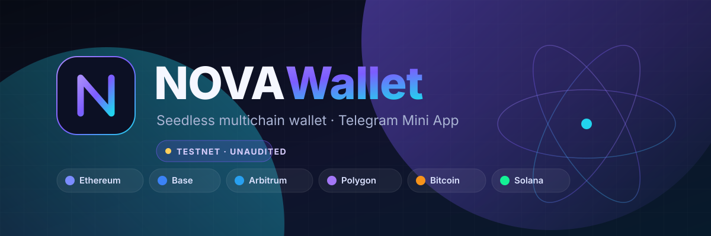
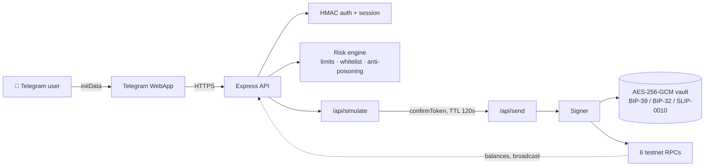

<p align="center">
  
</p>

<p align="center">
  <a href="https://github.com/AlekseyZHL/NOVA/actions/workflows/ci.yml"></a>
  <a href="https://github.com/AlekseyZHL/NOVA/actions/workflows/codeql.yml"></a>
  <a href="https://codespaces.new/AlekseyZHL/NOVA"></a>
  <a href="https://render.com/deploy?repo=https://github.com/AlekseyZHL/NOVA"></a>
  
  
  
  <a href="LICENSE"></a>
  <a href="CONTRIBUTING.md"></a>
</p>

<p align="center">
  <strong>Telegram Mini App · 6 сетей · вход без сид-фразы · симуляция каждой транзакции до подписи</strong>
</p>

> [!WARNING]
> **TESTNET MVP · БЕЗ АУДИТА · КАСТОДИАЛЬНЫЙ.** Не используйте для реальных средств.
> Сервер хранит зашифрованный master seed, `ALLOW_MAINNET=false` выставлен намеренно.
> До продакшена нужны независимый аудит, KMS/HSM, PostgreSQL, rate limiting и юркомплаенс.
> Подробнее — в [SECURITY.md](SECURITY.md) и [docs/SECURITY.md](docs/SECURITY.md).

> [!NOTE]
> **English (TL;DR):** NOVA Wallet is a seedless, custodial multichain wallet delivered as a
> Telegram Mini App. It derives real BIP-39/BIP-32/SLIP-0010 keys, shows live testnet balances,
> simulates every transfer before signing, and enforces USD limits, an address whitelist and
> anti-poisoning checks. Ships with 48 automated checks, Docker, one-click PaaS configs and a
> GitHub Pages landing page. Testnet only — not audited, not for real funds.

---

## ✨ Что внутри

| | |
|---|---|
| 🔐 **Криптография** | BIP-39 (24 слова) в AES-256-GCM, EVM `m/44'/60'/0'/0/i`, BTC P2WPKH `m/84'/coin'/0'/0/i`, Solana SLIP-0010 ed25519. Реальные подписи ECDSA, PSBT, ed25519. |
| 🌐 **6 сетей** | Ethereum Sepolia · Base Sepolia · Arbitrum Sepolia · Polygon Amoy · Bitcoin Testnet4 · Solana Devnet. Живые балансы и курсы CoinGecko. |
| 🧠 **Безопасность** | Двухшаговое подтверждение с HMAC-токеном (TTL 120 с), лимиты `$250` / `$1000` в день, белый список, блокировка address poisoning, декодирование метода, аудит-лог. |
| 📱 **UX** | 5 экранов, тема Telegram, QR-приём и сканер, своп с котировкой, история, песочница, адресная книга, антифишинг-код, сокрытие балансов, €/$. |
| 🤖 **Бот** | [@crptNOVA_bot](https://t.me/crptNOVA_bot) — `/start`, `/balance`, `/address`, `/security`, `/help`, кнопка «Кошелёк». |
| 👤 **Вход** | Telegram `initData` (HMAC-SHA256 + `timingSafeEqual`) → сессия на 7 дней. Запасной путь через `#tgWebAppData`, гостевой режим для браузера. |

---

## 🚀 Быстрый старт

```bash
git clone https://github.com/AlekseyZHL/NOVA.git
cd NOVA
npm ci
npm run setup          # создаст .env с VAULT_KEY и SESSION_SECRET (права 0600)
npm start              # http://localhost:3000
```

Откройте `http://localhost:3000`. Первый запуск сам создаст и запечатает master seed в `data/vault.enc`.

> 🔴 **Сделайте офлайн-бэкап `.env` + `data/vault.enc`.** Без этой пары средства не восстановить.
> Инструкция: [docs/BACKUP_INSTRUCTIONS.md](docs/BACKUP_INSTRUCTIONS.md) и [docs/SECURITY.md](docs/SECURITY.md).

### Тесты

```bash
npm test               # 28 криптографических проверок (офлайн, без сети и средств)
npm run test:ui        # 16 UI-проверок в jsdom (нужен запущенный сервер)
npm run test:entry     # 4 проверки запасного входа через #tgWebAppData
```

**Итого 48 проверок, 0 провалов.** Отчёт: [docs/TEST_REPORT.md](docs/TEST_REPORT.md).

---

## 🤖 Telegram Mini App

1. Создайте бота через [@BotFather](https://t.me/BotFather) → `/newbot`.
2. Впишите токен в `.env`: `BOT_TOKEN=...`, а публичный HTTPS-адрес в `WEBAPP_URL=...`.
3. В BotFather задайте `/setdomain` → ваш домен **без** `https://` и пути.
4. `/setmenubutton` или просто перезапустите сервер — бот сам вызовет `setChatMenuButton`.
5. Напишите боту `/start`.

Полная инструкция: [docs/SETUP_TELEGRAM.md](docs/SETUP_TELEGRAM.md).

> ⚠️ Арена-превью `*.e2b.app` и `localhost` **не подходят** для Telegram: первый требует
> заголовок `e2b-traffic-access-token`, второй недоступен из WebView. Нужен настоящий HTTPS-домен.

---

## ☁️ Запуск прямо на GitHub

GitHub Pages отдаёт только статику, поэтому полный Node-бэкенд поднимается одним из трёх способов — всё уже настроено в репозитории:

| Способ | Что даёт | Как запустить |
|---|---|---|
| 💻 **Codespaces** | Контейнер на инфраструктуре GitHub, публичный URL порта 3000 | [](https://codespaces.new/AlekseyZHL/NOVA) → дождаться сборки → вкладка **PORTS** → порт 3000 → **Port Visibility → Public** |
| ▶️ **Actions: Live demo** | Runner GitHub + публичный HTTPS-туннель, до 5 часов | **Actions → Live demo → Run workflow** — URL появится в Job Summary и в артефакте `nova-live-url` |
| 🚀 **Render / Railway / Fly** | Постоянный хостинг, привязанный к этому репозиторию | [](https://render.com/deploy?repo=https://github.com/AlekseyZHL/NOVA) или см. [docs/DEPLOYMENT.md](docs/DEPLOYMENT.md) |

`.devcontainer/` сам ставит зависимости, создаёт `.env`, подставляет `WEBAPP_URL` из переменных Codespace и запускает сервер.
Чтобы в **Live demo** заработал Telegram-вход, добавьте секрет `BOT_TOKEN` в `Settings → Secrets and variables → Actions` — бот зарегистрирует кнопку меню на выданный туннель.

> ⚠️ Live demo работает до 5 часов и тратит минуты GitHub Actions. Для постоянного адреса используйте Codespaces или PaaS.

## 🐳 Docker

```bash
docker compose up -d --build
docker compose logs -f
# http://localhost:3000/healthz
```

Или чистый образ:

```bash
docker build -t nova-wallet .
docker run -p 3000:3000 \
  -e VAULT_KEY=$(openssl rand -hex 32) \
  -e SESSION_SECRET=$(openssl rand -hex 32) \
  -v nova-data:/app/data nova-wallet
```

> При первом старте без `VAULT_KEY` ключ генерируется — **сохраните его**, иначе `vault.enc`
> станет нечитаемым после пересоздания контейнера.

---

## ☁️ Деплой

Готовые конфиги лежат в корне — выберите свой вариант:

| Платформа | Файл | Комментарий |
|---|---|---|
| Render | [`render.yaml`](render.yaml) | Blueprint, health check `/healthz` |
| Railway | [`railway.json`](railway.json) | Nixpacks, том для `data/` |
| Fly.io | [`fly.toml`](fly.toml) | Постоянный volume под ключи |
| Любой PaaS | [`Procfile`](Procfile) | `web: node server/index.js` |
| VPS | [`docker-compose.yml`](docker-compose.yml) | Nginx + TLS — в гайде |

Подробная пошаговка, переменные окружения и чек-лист перед запуском: **[docs/DEPLOYMENT.md](docs/DEPLOYMENT.md)**.

🌐 **Лендинг** — это один автономный [`index.html`](index.html) в корне (без внешних зависимостей). Публикуется на GitHub Pages при любом режиме: **Deploy from a branch** (Jekyll отключён через `.nojekyll`) или **GitHub Actions** ([workflow](.github/workflows/pages.yml)). Включите Pages в `Settings → Pages`.

---

## 🏗 Архитектура



Полное описание: [docs/ARCHITECTURE.md](docs/ARCHITECTURE.md) · REST: [docs/API.md](docs/API.md).

---

## 📚 Документация

| Раздел | Файл |
|---|---|
| Обзор и API | [README.md](README.md) · [docs/API.md](docs/API.md) |
| Архитектура | [docs/ARCHITECTURE.md](docs/ARCHITECTURE.md) |
| Безопасность | [SECURITY.md](SECURITY.md) · [docs/SECURITY.md](docs/SECURITY.md) |
| Настройка Telegram | [docs/SETUP_TELEGRAM.md](docs/SETUP_TELEGRAM.md) |
| Пользовательский гайд | [docs/USER_GUIDE.md](docs/USER_GUIDE.md) |
| Деплой | [docs/DEPLOYMENT.md](docs/DEPLOYMENT.md) |
| Тестирование | [docs/TEST_REPORT.md](docs/TEST_REPORT.md) |
| Дорожная карта | [docs/ROADMAP.md](docs/ROADMAP.md) |
| История версий | [CHANGELOG.md](CHANGELOG.md) |

---

## 🗺 Честные ограничения

- **Кастодиальность.** Ключи на сервере. «Seedless» = Telegram-личность + деривация, а **не** MPC / социальное восстановление.
- **Краны.** Публичные Solana Devnet / Testnet4 faucet часто отдают `429` или требуют hCaptcha. Есть песочница, где всё помечено `SIM`.
- **Своп.** Ончейн-своп в mainnet отключён (`501`) до подключения аудированного DEX-агрегатора.
- **Нет аудита, KMS/HSM, PostgreSQL и rate limiting.** Mainnet включать нельзя.

Планы: [docs/ROADMAP.md](docs/ROADMAP.md).

---

## 🤝 Вклад

PR приветствуются. Прочитайте [CONTRIBUTING.md](CONTRIBUTING.md) и [CODE_OF_CONDUCT.md](CODE_OF_CONDUCT.md).
Перед PR: `npm test && npm run test:ui && npm run test:entry`.

Нашли уязвимость? **Не открывайте публичный issue** — см. [SECURITY.md](SECURITY.md).

## 📄 Лицензия

[MIT](LICENSE) © 2026 NOVA Wallet contributors. ПО поставляется «как есть», без гарантий.

---

<p align="center"><sub>Сделано с 🔐 и чаем. Тестовые сети, настоящая криптография, никаких реальных денег.</sub></p>
